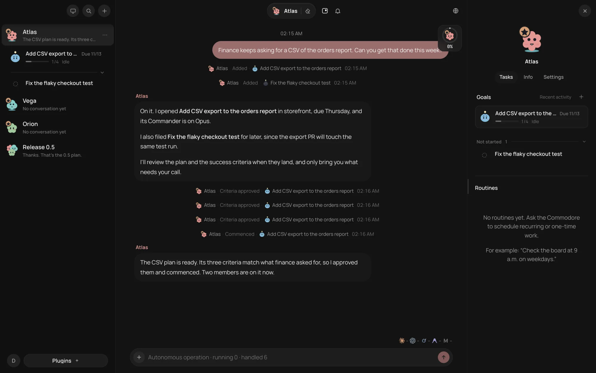
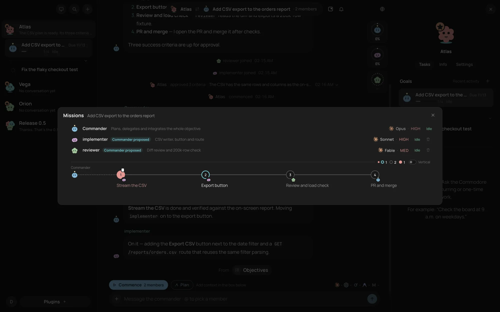
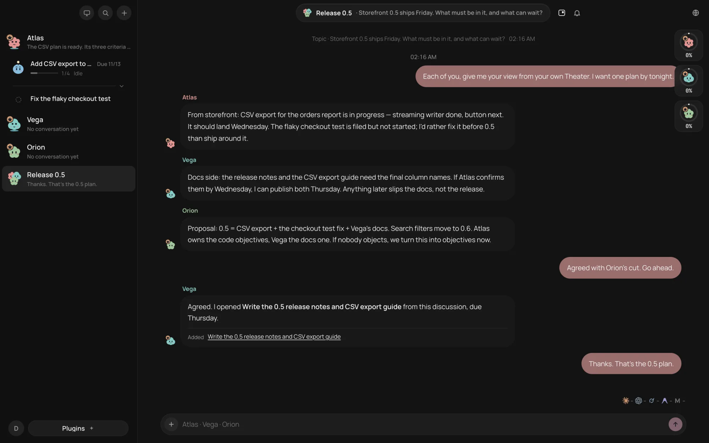
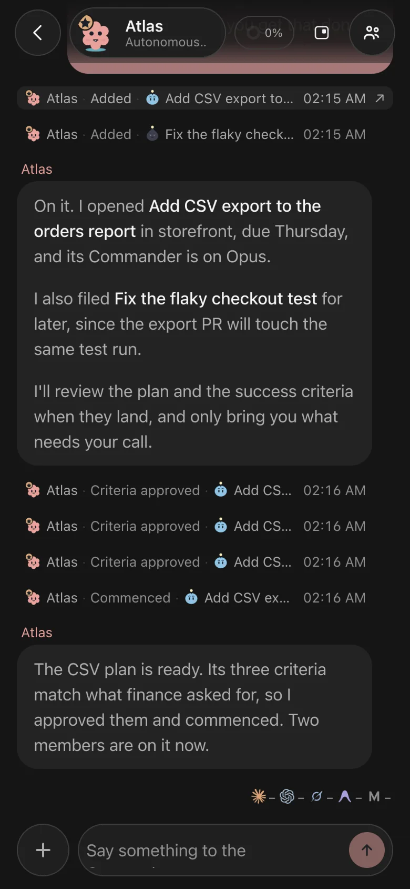

<p align="center">
  
</p>

<h1 align="center">Fleet</h1>

<p align="center">
  <b>여러 코딩 에이전트를 하나의 조용한 콘솔에서.</b><br/>
  일은 사령관에게 맡기고, 지휘관과 구성원이 어떤 프런티어 모델로든 해내게 하고,<br/>
  데스크톱이든 폰이든 지휘는 내 손에 두세요.
</p>

<p align="center">
  <a href="https://github.com/sbluemin/fleet-harness/releases/latest"></a>
  <a href="./LICENSE"></a>
  <a href="https://sbluemin.github.io/fleet-harness/?lang=ko"></a>
</p>

<p align="center">
  <a href="README.md">English</a> · <b>한국어</b>
</p>



## 시작하기

```bash
npm i -g https://github.com/sbluemin/fleet-harness/releases/latest/download/fleet-console.tgz
fleet console
```

`fleet console`을 실행하면 로컬 서버가 뜨고 접속 주소가 출력됩니다. 그 주소를 아무 브라우저에서나 여세요. Node.js 20.19 이상, 그리고 설치와 로그인을 마친 Claude Code가 필요합니다. 업데이트는 Console 화면이나 `fleet update`로 하세요.

## Fleet만의 것

**일은 사령관이 굴립니다.** 사령관은 내가 만드는 상설 조정자로, 자기 프로젝트 폴더(Theater)와 기억, 루틴을 가집니다. 필요한 일을 말하면 목표를 열고, 계획을 검토하고, 달성 기준을 승인하고, 개시합니다. 사령관이 정하면 안 되는 결정만 나에게 가져옵니다.

**목표는 지켜보지 않아도 끝까지 갑니다.** 목표마다 지휘관이 미션을 짜고 달성 기준을 제안하며, 구성원에게 일을 나눠 줍니다. 구성원은 저마다 모델과 강도가 다릅니다. 일은 계획에서 승인과 개시를 거쳐, 회고와 함께 돌아옵니다.



**태스크포스에서는 사령관들이 함께 정합니다.** 여러 사령관을 한 방에 모으면, 저마다 자기 Theater를 바탕으로 의견을 내고 나는 방향을 잡습니다. 결론은 그 자리에서 목표가 됩니다.



**어떤 프런티어 모델이든 Claude Code 그대로.** AI Gateway는 Claude Code 고유의 에이전트 루프를 Codex, Gemini(Antigravity), Grok(xAI), Muse Code 모델로 돌립니다. 이미 가진 구독을 그대로 쓰고, 자격 증명은 Console 안에 머뭅니다. 사령관과 지휘관은 내가 켜 둔 모델 가운데 남은 쿼터가 많은 순으로 모델을 고릅니다.

**에이전트와 함께 쓰는 브라우저.** 데스크톱 앱에서 플릿 브라우저는 대화 옆이나 별도 창에 열립니다. 에이전트는 같은 탭과 로그인을 쓰되 자기 공간에서 일하고, 나는 페이지에 주석을 달아 에이전트에게 넘길 수 있습니다.

**세션은 탭이 아니라 내 머신에 삽니다.** 페이지를 닫든, 브라우저를 다시 열든, 기기를 바꾸든 일은 계속됩니다. macOS·Windows 데스크톱 앱을 쓰거나, 원격 접속으로 폰이나 다른 컴퓨터를 페어링하거나, 테스터 배포 중인 Android·iOS 앱을 쓰세요.

<p align="center"></p>

## 기본은 로컬

원격 접속을 켜기 전까지 서버는 루프백에서만 듣습니다. 원격 접속은 15분 뒤 만료되는 일회용 링크로 기기를 페어링합니다. 세션과 설정, 기록은 `~/.fleet` 아래에 남습니다.

## 더 알아보기

- [데스크톱 가이드](runtime/fleet-desktop/README.md)
- [Fleet 개발 참고서](docs/fleet-development-reference.md)
- [변경 기록](CHANGELOG.ko.md)

<sub>스크린샷은 예시 데이터를 넣은 격리된 데모 Console에서 찍었습니다.</sub>

## 라이선스

[MIT](LICENSE)
