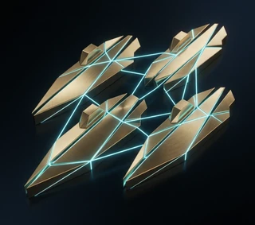
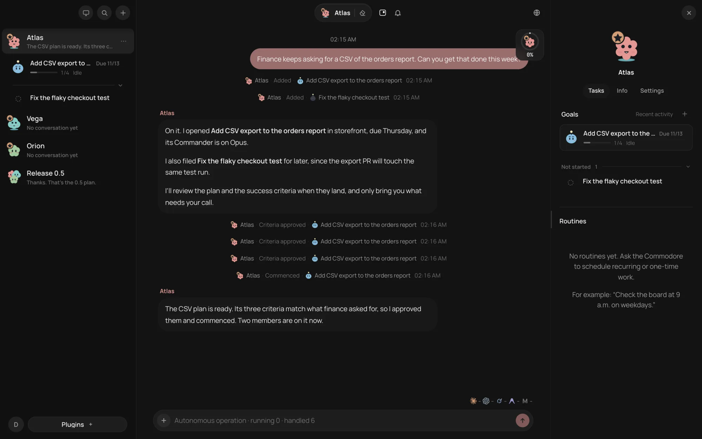
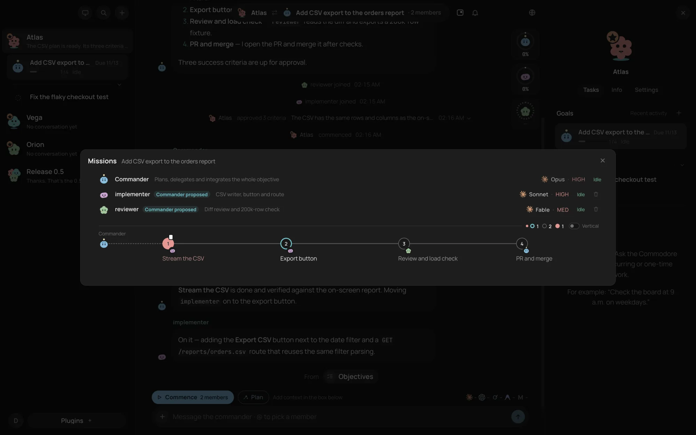
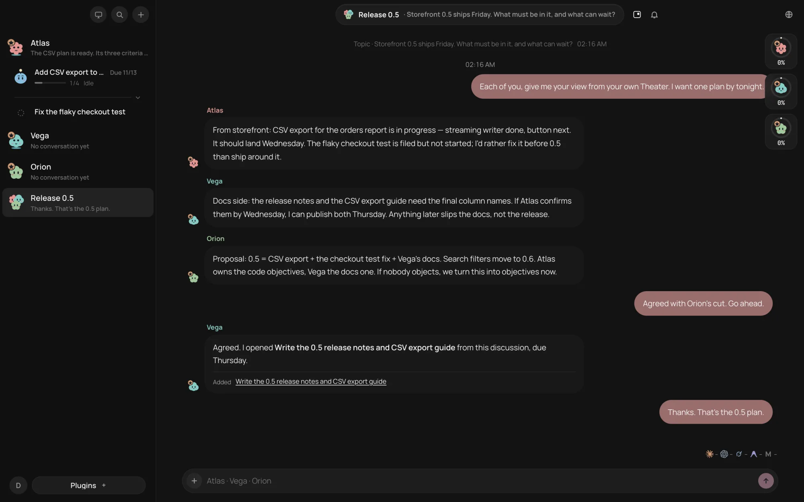
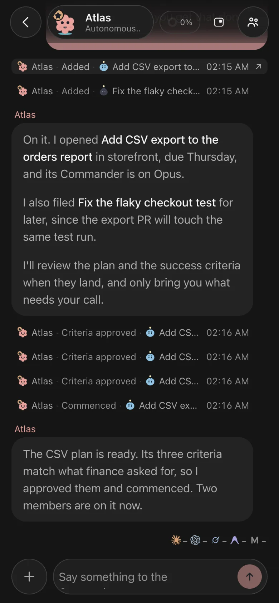

<p align="center">
  
</p>

<h1 align="center">Fleet</h1>

<p align="center">
  <b>Run a fleet of coding agents from one quiet console.</b><br/>
  Hand work to Commodores, let their Commanders and members carry it out on every frontier model,<br/>
  and stay in charge from the desktop or your phone.
</p>

<p align="center">
  <a href="https://github.com/sbluemin/fleet-harness/releases/latest"></a>
  <a href="./LICENSE"></a>
  <a href="https://sbluemin.github.io/fleet-harness/"></a>
</p>

<p align="center">
  <b>English</b> · <a href="README.ko.md">한국어</a>
</p>



## Start

```bash
npm i -g https://github.com/sbluemin/fleet-harness/releases/latest/download/fleet-console.tgz
fleet console
```

`fleet console` starts a local server and prints its address; open it in any browser. You need Node.js 20.19 or later and Claude Code installed and signed in. Update from the Console or with `fleet update`.

## What makes Fleet different

**Commodores run the work.** A Commodore is a standing coordinator you create, with its own project folders (Theaters), memory and routines. Tell it what you need; it opens objectives, reviews their plans, approves criteria, commences them, and brings you only the decisions it should not make.

**Objectives finish without you babysitting them.** Each objective has a Commander that lays out missions, proposes success criteria and delegates to members, each on its own model and effort. Work moves from plan to approval to commencement, and comes back with a retrospective.



**TaskForce lets Commodores decide together.** Put several Commodores in one room. Each answers from its own Theaters, you steer, and the conclusion becomes objectives right there.



**Every frontier model, behind Claude Code.** The AI Gateway runs Claude Code's own agent loop on Codex, Gemini (Antigravity), Grok (xAI) and Muse Code models with the subscriptions you already have. Their credentials stay in the Console. When Commodores and Commanders pick models, they choose from the ones you turned on, ordered by remaining quota.

**A browser you share with your agents.** In the desktop app, Fleet Browser opens beside the conversation or in its own window. Agents work in their own spaces on the same tabs and sign-ins, and you can annotate a page to hand it to them.

**Sessions live on your machine, not in the tab.** Close the page, restart the browser, or switch devices; the work keeps running. Use the desktop app for macOS and Windows, pair a phone or another computer through remote access, or use the Android and iOS apps in tester distribution.

<p align="center"></p>

## Local by default

The server listens only on loopback until you turn on remote access, which pairs devices with one-use links that expire in 15 minutes. Sessions, settings and history stay under `~/.fleet`.

## Go deeper

- [Desktop guide](runtime/fleet-desktop/README.md)
- [Fleet Development Reference](docs/fleet-development-reference.md)
- [Changelog](CHANGELOG.md)

<sub>Screenshots come from an isolated demo Console with sample data.</sub>

## License

[MIT](LICENSE)
