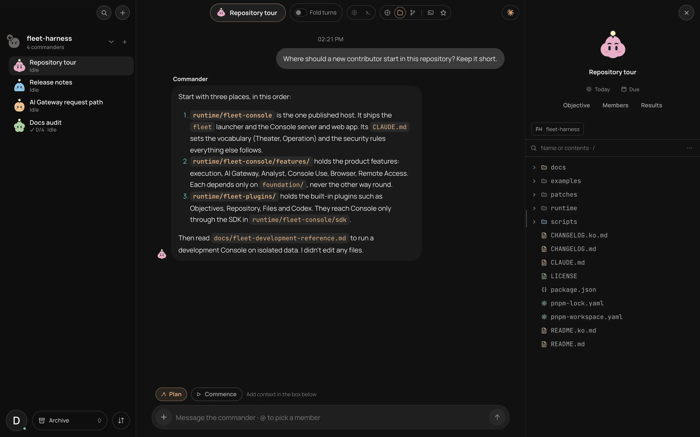
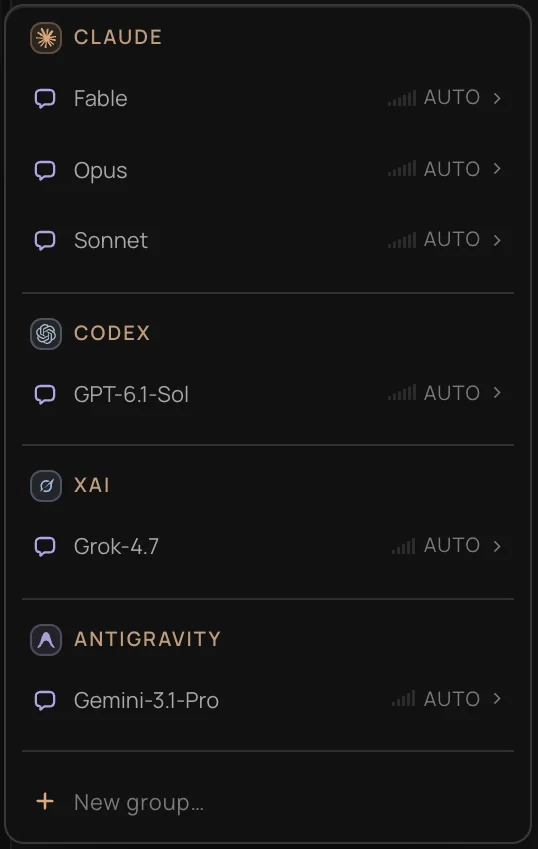
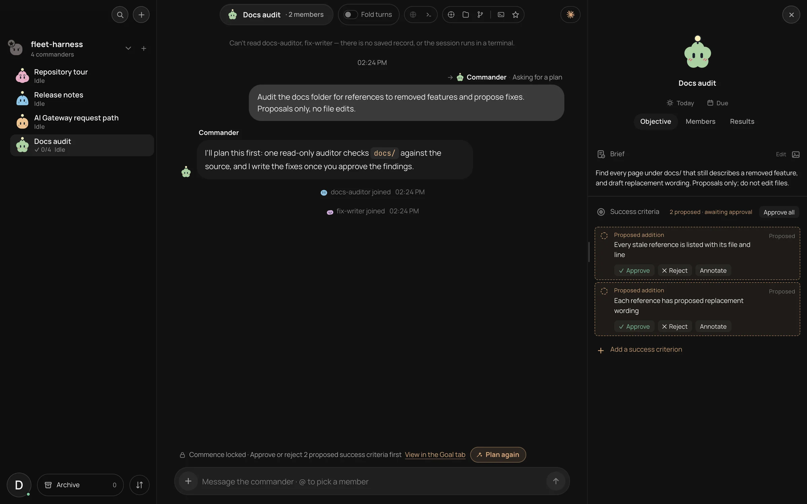
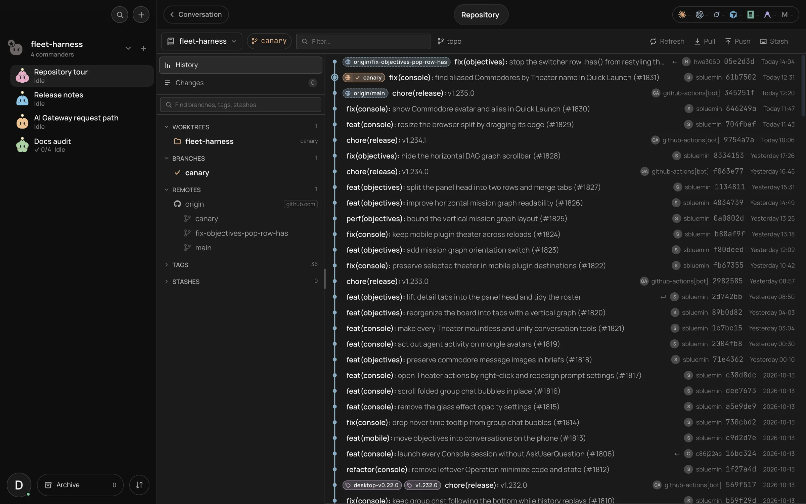
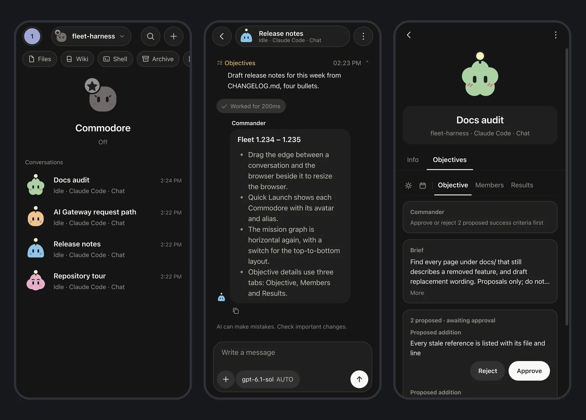

<p align="center">
  
</p>

<h1 align="center">Fleet</h1>

<p align="center">
  <b>A quiet console for a fleet of coding agents.</b><br/>
  Run Claude Code on every frontier model, keep each session alive on your own machine,<br/>
  and supervise the whole fleet from a browser, the desktop app, or your phone.
</p>

<p align="center">
  <a href="https://github.com/sbluemin/fleet-harness/releases/latest"></a>
  <a href="./LICENSE"></a>
  <a href="https://sbluemin.github.io/fleet-harness/"></a>
</p>

<p align="center">
  <b>English</b> · <a href="README.ko.md">한국어</a>
</p>

<br/>



<p align="center"><sub>One Theater, four conversations on different models. The Repository tour is open in the middle, with Files beside it. Captured from a demo session on a copy of this repository.</sub></p>

<br/>

## Start

```bash
npm i -g https://github.com/sbluemin/fleet-harness/releases/latest/download/fleet-console.tgz
fleet console
```

`fleet console` starts a local server and prints its address. Open that address in any browser. You need Node.js 20.19 or later and Claude Code installed and signed in. Running `fleet` on its own opens Claude Code in your terminal, routed through the same AI Gateway.

Update from the Console or with `fleet update`. `npm update -g` rolls Fleet back to the old version left on npm.

Press the **+** at the top of the sidebar to open a new session. Add a project folder as a **Theater** with **Add Theater…** there, pick the model and effort, and send your first message, or start from <kbd>⌘</kbd><kbd>J</kbd>.

## Sessions that outlive the tab

Each conversation is a Claude Code session owned by the Fleet server, not by the page you're looking at. You can close the tab, reload, or switch devices, and the session keeps running. When you come back, the conversation is still there. A conversation reads as chat by default, and you can reopen the same session in a full terminal. A session that has ended, for example after the Console restarts, comes back with **Resume**. A closed panel can be reopened with <kbd>⌘</kbd><kbd>Z</kbd>.

## Every frontier model, behind one launch menu



The launch menu lists Claude's own models first, then every gateway model you've enabled under **Settings → AI Gateway**. The same list appears in Claude Code's `/model` picker.

The gateway is a local Claude Code endpoint, not an API proxy. Claude Code keeps its native agent loop and tools. Other vendors' credentials stay inside the Console and never enter the agent process. Fleet reuses the sign-in you already have in each vendor's own CLI.

<br clear="right"/>

| Provider | Sign-in | Models |
|---|---|---|
| **Codex** | ChatGPT subscription | GPT-6.1 Sol, GPT-6 Astra · Sol · Luna, GPT-5.6 Terra, each at 272K, 524K or 1M context, with a Fast twin |
| **Antigravity** | Google subscription | Gemini 3.8 Flash · Gemini 3.1 Pro |
| **xAI** | Grok subscription | Grok 4.7 · Grok 4.7 Fast · Grok Composer 2.5 Fast |
| **Cursor** | Cursor subscription | Grok 4.7 · Grok 4.7 Fast, each at 256K or 500K context · Muse Spark 1.3 at 300K or 1M |
| **Muse Code** | Muse Code subscription | Muse Spark 1.3 · Muse Spark 1.3 Contributor |

Each model carries its own reasoning ladder. Every row also offers **ULTRACODE**, which launches Claude Code at xhigh effort with standing multi-agent orchestration. With **AI Gateway routing** turned on, subagents and workflow stages are assigned to gateway models, and providers whose usage window is nearly spent are skipped. The usage meters at the top right use the same measure, so you see a window running hot before it stops a run.

## Hand off work that takes more than one turn



Every conversation is led by a **Commander**. You can simply talk to it, or turn the request into an **Objective**: work you hand off whole.

1. **Plan.** Write what you want and press **Plan**. The Commander lays out missions, their prerequisites, and the member sessions it needs, and proposes success criteria. Nothing runs yet.
2. **Approve.** You approve, reject, or annotate each proposed criterion, and can add your own.
3. **Commence.** The Commander works the missions itself or passes them to members. Each member has its own role, model, and effort. The Commander and its members share one group conversation, where you can @mention a member, stop the work, or answer the decisions they ask you to make.
4. **Hand-off.** The objective comes back with a retrospective. You review it, complete it, and can turn follow-up candidates into new objectives.

An objective's brief, criteria, members, mission graph, and results sit in the details column beside its conversation. You can also answer decisions, commence, and complete objectives from your phone.

## Let the Commodore run a Theater

Each Theater has a **Commodore**: a coordinator that can run the Theater's objectives on its own. Turn on autonomous operation with the Commodore glyph on the Theater's header. The Commodore then creates objectives from a title and brief, leaves the plan to each Commander, commences and reviews them, and answers Commanders' questions. Decisions it should not make wait for you under **Your decisions**, and it can ask you directly. Click the Theater's header to open its **Theater Inbox**, with the Commodore's log, directive, and settings beside the Theater's system prompt. You can hand a single objective to the Commodore from its sidebar row, and while it runs the Theater you can message it from Quick Launch with `@`.

## One conversation at a time

The desktop screen is a conversation. The sidebar lists each Theater's conversations, the middle holds the one you're in, and the details column on the right shows that conversation's objective or the tool you opened. <kbd>Alt</kbd><kbd>←</kbd> and <kbd>Alt</kbd><kbd>→</kbd> move between conversations in the active Theater. Every session has an avatar that acts out what it is doing, and you can pick another character or color for it.

<kbd>⌘</kbd><kbd>K</kbd> jumps to any conversation, file, or wiki page. <kbd>⌘</kbd><kbd>P</kbd> opens the command palette, <kbd>⌘</kbd><kbd>J</kbd> opens Quick Launch, <kbd>⌘</kbd><kbd>⇧</kbd><kbd>Y</kbd> toggles Objectives, and <kbd>Alt</kbd><kbd>S</kbd> sorts the sidebar by status. Every shortcut can be rebound. On Windows and Linux, <kbd>⌘</kbd> is <kbd>Ctrl</kbd>.

## The project, beside the conversation



A tool bar above every conversation opens tools for that conversation's Theater:

- **Repository**: history, changes, compare, worktrees, branches, tags, and stashes.
- **Files**: a tree with quick peek, pinned folders, and git status tints.
- **Shell**: one terminal for the whole Console, a keystroke away (<kbd>Ctrl</kbd><kbd>`</kbd>).
- **Codex**: the project wiki. An experimental Cowork mode lets an AI draft edits to a page, and nothing changes until you apply them.
- **Skills**: browse and install skills.

Provider quotas stay in view as usage meters at the top right; click them for the details.

Beside a conversation you can also open:

- **Session Browser** (<kbd>Alt</kbd><kbd>B</kbd>, Desktop only) is a browser the agent drives on the same tabs you see, and you can annotate a page for it. The **Fleet Browser** (<kbd>⌘</kbd><kbd>⇧</kbd><kbd>B</kbd>, Desktop only) is your own browser beside the conversation. Drag the edge between them to resize it.

With **Console Use**, agents can operate the Console itself. **Computer Use** extends that to Mac apps. Both are granted per session, and each request is approved inside the panel.

## On any screen

**Desktop.** Fleet Console Desktop is a thin native shell for macOS, Windows, and Linux, available from [GitHub Releases](https://github.com/sbluemin/fleet-harness/releases/latest). It manages its own Console runtime and updates itself on macOS and Windows.

**Remote access.** Remote access is off until you set it up on the **Remote access** page in Settings. Once it is on, a Console opens only to devices you pair:

- Access links work once and expire after 15 minutes.
- Every link is pinned to the Console's certificate.
- Only one device controls at a time; the others watch behind a clear curtain.
- Monitoring-only links let a screen watch without typing.
- Reaching the Console over the public internet is a separate opt-in.



**Mobile.** The conversations you left on your desk are on your phone too. The home screen lists them with the Theater's Commodore at the top, and an objective's board opens from its conversation, so you can approve criteria, answer decisions, and commence or complete work. The Android and iOS apps are in tester distribution; the source lives in [`runtime/fleet-mobile`](runtime/fleet-mobile).

## Local by default

- The server binds to loopback. Nothing is reachable from other machines until you enable remote access.
- Provider credentials stay in the Console. The browser only receives one-use terminal tickets.
- Sessions, settings, and history live on your machine under `~/.fleet`.

## Make it yours

Choose a **Dark** or **Light** theme. You can pick interface and terminal fonts from those installed on your machine, reduce motion or keep avatars calm, and rebind every shortcut. The Console speaks English and Korean and switches between them without a reload.

## Go deeper

- [Fleet Development Reference](docs/fleet-development-reference.md): extend hosts, build plugins, and run an isolated development Console
- [Console Agent SDK](docs/console-agent-sdk.md): the contracts plugins build on
- [Admiral Workflow Reference](docs/admiral-workflow-reference.md): orchestration architecture and doctrine
- [Desktop guide](runtime/fleet-desktop/README.md): artifacts, updates, and current limits
- [Changelog](CHANGELOG.md): release history

## License

[MIT](LICENSE)
